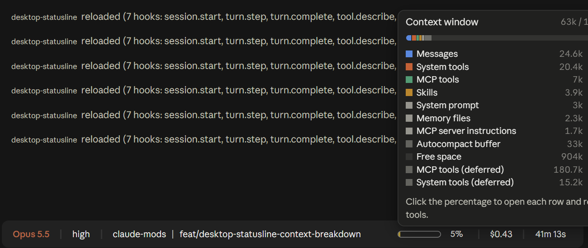

<h1 align="center">claude-mods</h1>
<p align="center">
  <a href="https://github.com/jiroamato/claude-mods/actions/workflows/ci.yml"
    ></a>
  <a href="https://github.com/jiroamato/claude-mods/releases"
    ></a>
  <a href="https://claude.ai/download"
    ></a>
  <a href="https://x.com/Jiro0x"
    ></a>
</p>

A plugin marketplace of mods for [Claude Code](https://code.claude.com): live UI
plugins built on function hooks.

## Plugins

### desktop-statusline

A status bar above the prompt in the Claude desktop app's Code tab. It mirrors
the figures a terminal status line shows, its text in the app's own theme colours:


- **Model** in the Claude accent, with the session's reasoning **effort** beside it,
  coloured from quiet (low) to warning and error tones (x-high, max).
- **Folder** and **git branch**, with a dot when the working copy has uncommitted changes.
- **Context meter**: a hollow rounded rectangle that fills as the context window does.
- **Cost** so far and **elapsed** session time. Seconds are dropped past an hour.

#### Context breakdown

Hover the context meter to see what fills the context window, row by row as
`/context` lists it: the system prompt, system tools, MCP tools, memory files,
skills and messages, then the autocompact buffer, the free space and the tools
loaded on demand, each with its tokens and its share of the window. The rows are
counted as `/context` counts them, so the two agree.



Click the percentage beside the meter to open the **Context** pane. It shows the
same rows, and each one with something in it opens to list what fills it:

- **System prompt**: each section of the prompt as this session composes it, with
  its approximate size. Open a section to read its text.
- **System tools**: every built-in tool with a one-line summary and its approximate
  size. **Remove** takes a tool out of the open session at once (its schema leaves
  the context and Claude can no longer call it) and adds its name to
  `permissions.deny` in your user settings (`~/.claude/settings.json`, or
  `$CLAUDE_CONFIG_DIR`), so new sessions in every project start without it.
  **Put back** undoes both. A tool the session started without comes back in the
  next session. Deleting the name from `permissions.deny` by hand works too.
- **System tools (deferred)**: the built-in tools loaded only when Claude searches
  for them, which can be removed the same way.
- **MCP tools**, in the window and loaded on demand: each server and its tools.
- **Skills**, read-only for now, **Memory files**, **Custom agents**, and
  **Messages**, which lists the largest tool results in the conversation.


It draws on the desktop surface only. In the terminal it stays out of the way,
so a `statusLine` command in your settings keeps working there.

## Install in the Claude desktop app

Everything happens inside the app. No terminal needed.

**1. Open the plugin settings.** In the Claude desktop app, open **Settings**
and choose **Plugins** in the sidebar, under _Customize_.

**2. Add this marketplace.** Click the **Add** button at the top right, then
**Add marketplace**, then **Add from a repository**. Paste the repository URL:

```
https://github.com/jiroamato/claude-mods
```

Press **Sync**. The app fetches the catalogue and **claude-mods** joins your
marketplaces.

**3. Install the plugin.** **Desktop statusline** by Jiro Amato now appears in
the list. Click its **Add** button and pick a scope:

- **Install for me** puts it in `~/.claude/`, so the band is on in every
  project on this machine. This is the one to choose for a status bar.
- **Install for project (shared)** or **(personal)** limits it to the current
  project instead.

**4. Start a new session.** Open a fresh Code session and the band appears
above the prompt. Running sessions keep what they had until they end.

**Later.** Enable, disable or remove it from the same **Plugins** page, through
the menu at the end of its row. Marketplaces are managed under **Add >
Manage marketplaces**, and new versions published here arrive through a sync.

<details>
<summary>Prefer the terminal?</summary>

The terminal and the desktop app share one plugin configuration, so these two
commands give the same result:

```bash
claude plugin marketplace add jiroamato/claude-mods
```

```bash
claude plugin install desktop-statusline@claude-mods
```

</details>

## Develop

Function hooks are an early-access API: the surface may change between Claude
Code releases, and the plugin is written against the version named in each
release's notes. Each plugin folder is self-contained:

```
desktop-statusline/
  .claude-plugin/plugin.json   manifest
  hooks/hooks.json             names the hooks module
  hooks/register.tsx           the mod: hooks, state and the band's tree
  hooks/panel.tsx              the context breakdown's hover card and pane
  hooks/context.ts             the window broken down into /context's rows
  hooks/tools.ts               tool summaries, sizes and the settings deny edit
  types/index.d.ts             its state contract
  tests/                       run with `claude plugin test`
```

Validate, test and type-check a plugin by passing its folder:

```bash
claude plugin validate --strict desktop-statusline
```

```bash
claude plugin test desktop-statusline
```

Loading it in a session lays the engine's typings beside the manifest, after
which `tsc -p desktop-statusline` type-checks it. Those generated files are
ignored by git.

To hack on it live, point a session at the folder: `claude --plugin-dir
./desktop-statusline`, or set `CLAUDE_CODE_PLUGIN_DIRS` in the `env` block of
`~/.claude/settings.json`. Saving a file reloads the mod in that session.

See [CONTRIBUTING.md](CONTRIBUTING.md) for the contributor workflow.

## License

MIT
