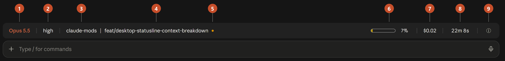
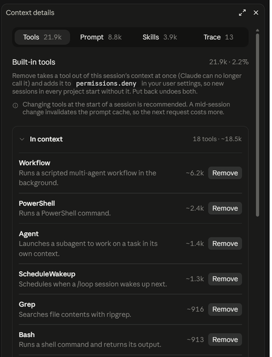

<h1 align="center">desktop-statusline</h1>
<p align="center">
  <a href="https://github.com/jiroamato/claude-mods/releases"
    ></a>
  <a href="https://www.npmjs.com/package/@jiroamato/desktop-statusline"
    ></a>
  <a href="https://claude.ai/download"
    ></a>
</p>

A [Claude Code](https://code.claude.com) plugin from the
[claude-mods](https://github.com/jiroamato/claude-mods) marketplace, built on function hooks.


A status bar above the prompt in the Claude desktop app's Code tab, its text in the
app's own theme colours:



1. **Model**, in the Claude accent.
2. **Effort**: the session's reasoning effort, coloured from quiet (low) to warning and
   error tones (x-high, max).
3. **Folder** the session works in.
4. **Git branch**.
5. **Uncommitted changes**: a dot when the working copy has them.
6. **Context meter**: a hollow rounded rectangle that fills as the context window does,
   and the share of it used.
7. **Cost** so far.
8. **Elapsed** session time. Seconds are dropped past an hour.
9. **ⓘ**: opens the [Context details](#context-details) pane.

## Context details

Click the ⓘ to open the Context details pane. Its four tabs show what the app's own
Context card leaves out.



- **Tools.** Every built-in tool and its size. **Remove** takes a tool out of the session
  and adds it to `permissions.deny` in your user settings. **Put back** undoes both.
- **Prompt.** The system prompt section by section, with sizes. With tracing on, it
  shows the prompt exactly as the last request sent it.
- **Skills.** Every skill listing Claude sees, yours apart from the built-in ones.
- **Trace.** Every request the session sends to the model, with its tokens, cost and
  time. Open one to read and search it, or open it in your browser.

Remove tools at the start of a session. A change mid-session resets the prompt cache,
so the next request costs more.

### Tracing

**Turn on tracing** in the Trace tab adds these variables to the `env` block of
`~/.claude/settings.json`, or the settings in `$CLAUDE_CONFIG_DIR`. Every session you
start after that is traced, in the terminal and in the desktop app.

| Variable                              | Value                            |
| ------------------------------------- | -------------------------------- |
| `CLAUDE_CODE_ENABLE_TELEMETRY`        | `1`                              |
| `OTEL_LOGS_EXPORTER`                  | `otlp`                           |
| `OTEL_EXPORTER_OTLP_LOGS_PROTOCOL`    | `http/json`                      |
| `OTEL_EXPORTER_OTLP_LOGS_ENDPOINT`    | `http://127.0.0.1:43180/v1/logs` |
| `OTEL_LOGS_EXPORT_INTERVAL`           | `1000`                           |
| `OTEL_LOG_RAW_API_BODIES`             | `1`                              |
| `CLAUDE_CODE_OTEL_CONTENT_MAX_LENGTH` | `20000000`                       |

**Turn off tracing** puts back what you had under those names, and removes the ones
you never set.

A local receiver, run with [Node.js](https://nodejs.org) from your `PATH`, saves the
requests to `~/.claude/desktop-statusline/traces/`. Delete that folder to clear them.

A trace holds the whole conversation, file contents and command output included. It
stays on your machine unless your organization's settings send telemetry elsewhere.
On a machine shared with other users, another user could feed the receiver records
or take its port.

The band only draws in the desktop app. In the terminal, your own `statusLine`
command keeps working.

## Install

### With npx

With [Node.js](https://nodejs.org), one command adds the claude-mods marketplace and
installs the plugin for you:

```bash
npx @jiroamato/desktop-statusline
```

Running it again is safe: it keeps what is already there, and turns the plugin
back on if you disabled it. It needs the `claude` command on your `PATH`; without
it, install from the desktop app instead.

### In the Claude desktop app

Everything happens inside the app. No terminal needed.

**1. Open the plugin settings.** In the Claude desktop app, open **Settings**
and choose **Plugins** in the sidebar, under _Customize_.

**2. Add the marketplace.** Click the **Add** button at the top right, then
**Add marketplace**, then **Add from a repository**. Paste the repository URL:

```
https://github.com/jiroamato/claude-mods
```

Press **Sync**. The app fetches the catalogue and **claude-mods** joins your
marketplaces.

**3. Install the plugin.** **Desktop statusline** by Jiro Amato now appears in
the list. Click its **Add** button and pick a scope:

- **Install for me** puts it in `~/.claude/`, so the band is on in every
  project on this machine. This is the one to choose for a status bar.
- **Install for project (shared)** or **(personal)** limits it to the current
  project instead.

**4. Start a new session.** Open a fresh Code session and the band appears
above the prompt. Running sessions keep what they had until they end.

**Later.** Enable, disable or remove it from the same **Plugins** page, through
the menu at the end of its row. Marketplaces are managed under **Add >
Manage marketplaces**, and new versions published here arrive through a sync.

### With the claude CLI

The terminal and the desktop app share one plugin configuration, so these two
commands give the same result as the steps above:

```bash
claude plugin marketplace add jiroamato/claude-mods
```

```bash
claude plugin install desktop-statusline@claude-mods
```

## Develop

Function hooks are an early-access API: the surface may change between Claude
Code releases, and the plugin is written against the version named in each
release's notes. Everything it needs is in this folder:

```
desktop-statusline/
  .claude-plugin/plugin.json   manifest
  hooks/hooks.json             names the hooks module
  hooks/register.tsx           the mod: hooks, state and the band's tree
  hooks/elapsed.tsx            the band's timer, a region that counts its own seconds
  hooks/duration.ts            a duration as the band writes it
  hooks/panel.tsx              the Context details pane
  hooks/tabs.tsx               a tab of the pane, a region of its own
  hooks/disclosure.tsx         a row of the pane that opens and closes
  hooks/reader.tsx             the reader's top line: the way back
  hooks/text.tsx               the reader's text, with its scrollbar
  hooks/context.ts             the window broken down as /context counts it
  hooks/tools.ts               tool summaries, sizes and the settings deny edit
  hooks/folder.ts              opening the traces folder in the file manager
  hooks/trace.ts               tracing's settings, and a trace read for the pane
  trace/receiver.mjs           the trace receiver, run with Node
  trace/store.mjs              what the receiver keeps of each request
  trace/view.mjs               the receiver's pages for the browser
  trace/*.d.mts                their types, for the hooks and the tests
  types/index.d.ts             its state contract
  tests/                       run with `claude plugin test`
  docs/                        this README's screenshots and demo
  package.json                 the npm package, @jiroamato/desktop-statusline
  install.mjs                  its installer, what `npx` runs
  pack-docs.mjs                readies this README and the LICENSE while npm packs it
```

Validate, test and type-check it, and hack on it live, as the
[repository README](../README.md#develop) describes for every plugin. See
[CONTRIBUTING.md](../CONTRIBUTING.md) for the contributor workflow.

## License

[MIT](../LICENSE)
